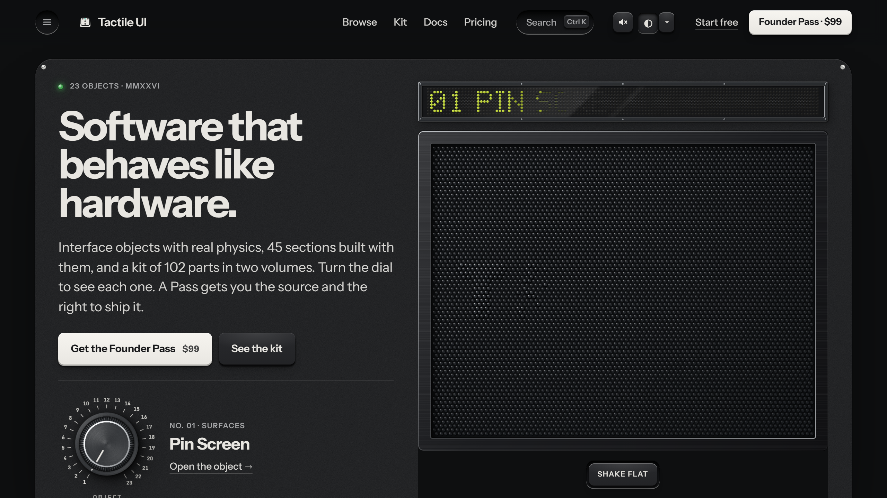
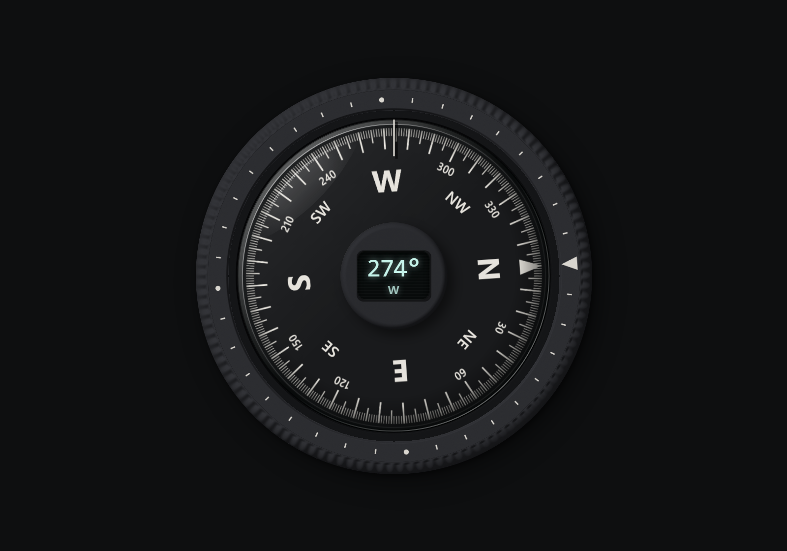
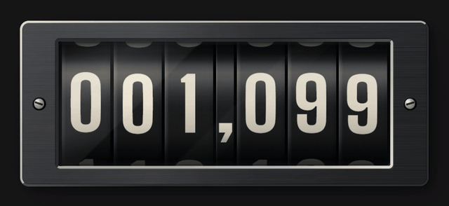
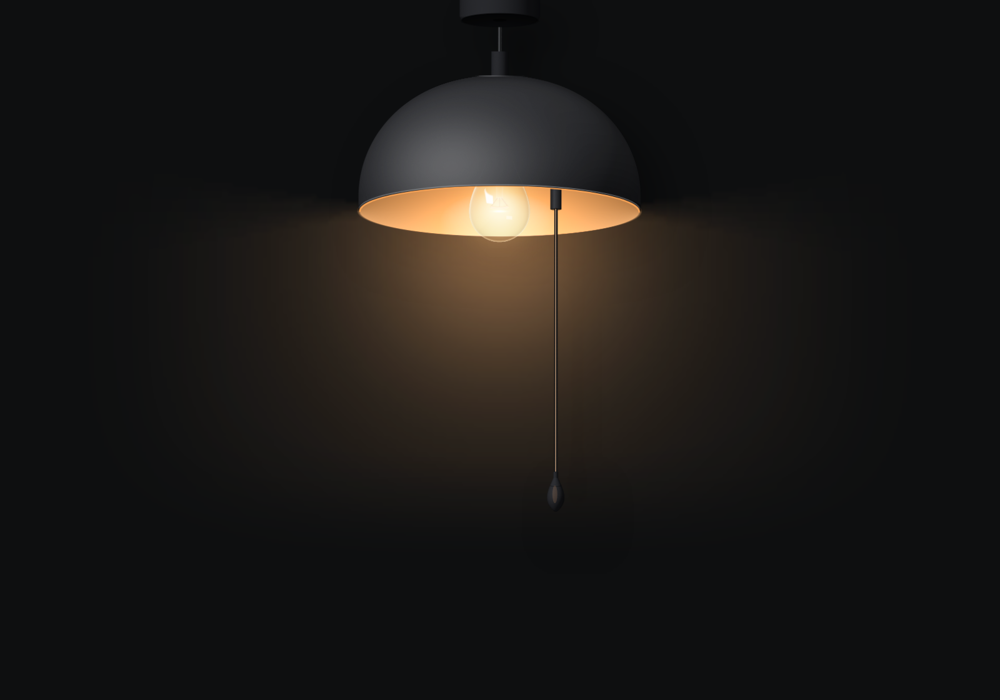
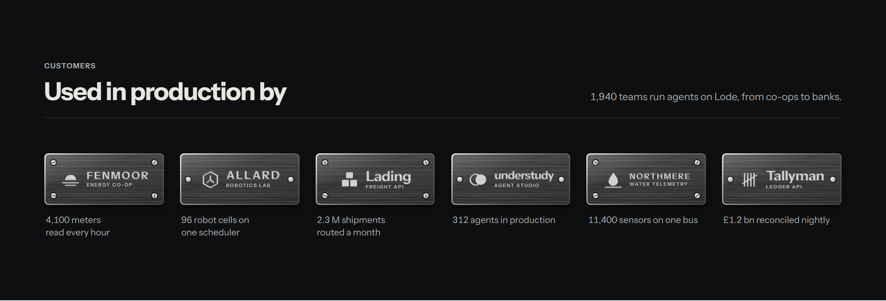
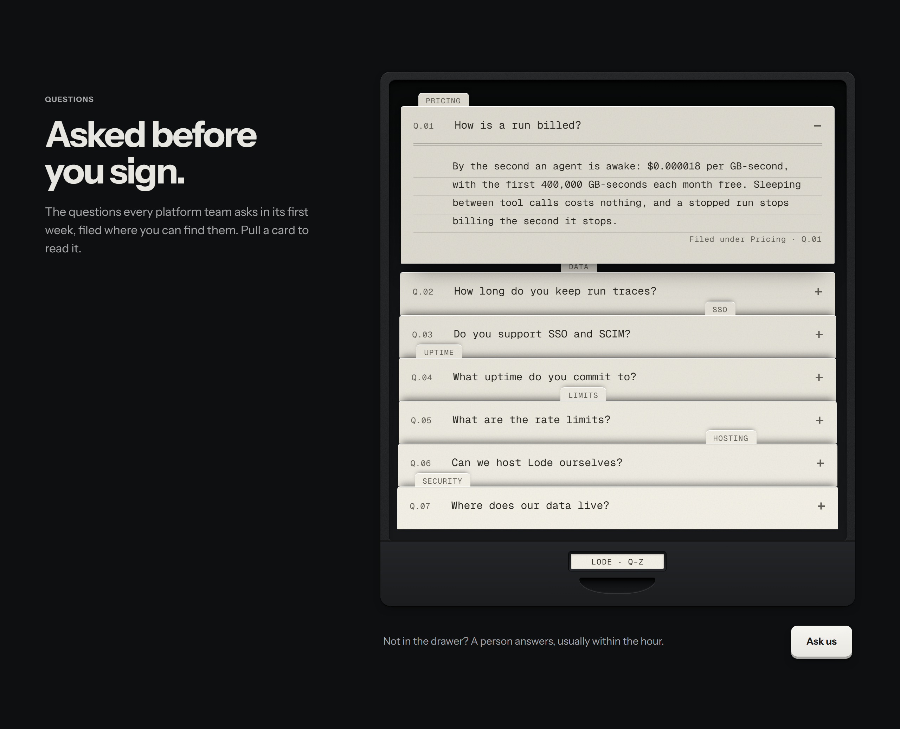
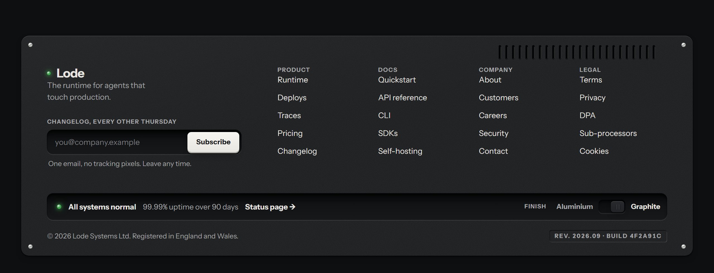

<p align="center"><a href="https://tactileui.dev"></a></p>

# Tactile UI Free

Interface parts that behave like the objects they are drawn from: a counter whose drums carry, a compass that settles on its bearing, a light on a pull cord. Plain JavaScript modules and CSS, no framework, no build step, no dependencies.

This repo is the free, open-source part of [Tactile UI](https://tactileui.dev): 6 pieces under the MIT licence, to use, change and ship anywhere.

<p><a href="compass/"></a>
<a href="odometer/"></a>
<a href="pull-cord/"></a>
<a href="client-plates/"></a>
<a href="faq-drawer/"></a>
<a href="machined-footer/"></a></p>

| Piece | Kind | What it is | |
| --- | --- | --- | --- |
| [Compass](compass/) | Object | A liquid-damped compass. | [Live](https://tactileui.dev/objects/compass) |
| [Odometer](odometer/) | Object | A mechanical drum counter. | [Live](https://tactileui.dev/objects/odometer) |
| [Pull-cord Bulb](pull-cord/) | Object | A pendant lamp that is a switch. | [Live](https://tactileui.dev/objects/pull-cord) |
| [Engraved Client Plates](client-plates/) | Block | “Used in production by…”, as metal name plates. | [Live](https://tactileui.dev/blocks/client-plates) |
| [FAQ Index](faq-drawer/) | Block | An FAQ as a card-index drawer. | [Live](https://tactileui.dev/blocks/faq-drawer) |
| [Machined Footer](machined-footer/) | Block | A footer made as the bottom panel of a device. | [Live](https://tactileui.dev/blocks/machined-footer) |

## Install

Each piece is a folder you can copy as it is. Or add one with shadcn:

```sh
npx shadcn add https://tactileui.dev/r/compass.json
```

The registry of the free pieces is `https://tactileui.dev/r/free/registry.json`. The Odometer is also on npm:

```sh
npm install tactile-odometer
```

Every piece works by keyboard and touch, respects reduced motion, and stops drawing when nothing moves.

## The whole library

What's here is a sample. [Tactile UI](https://tactileui.dev) has 23 objects, 45 blocks, 102 kit parts and 15 templates in the same language, in every finish, with React, Vue and Svelte wrappers and a custom element for each. More are free with an account; the [Founder Pass](https://tactileui.dev/pricing) opens all of it, and what comes next.

- [Browse everything](https://tactileui.dev/c/all)
- [What's free and what's paid](https://tactileui.dev/docs/free-and-paid)
- [Docs](https://tactileui.dev/docs/introduction)

## Licence

MIT, see [LICENSE](LICENSE). The fonts in a piece's folder are under the SIL Open Font Licence, beside them. Everything else in Tactile UI is under the [Tactile UI licence](https://tactileui.dev/licence).
